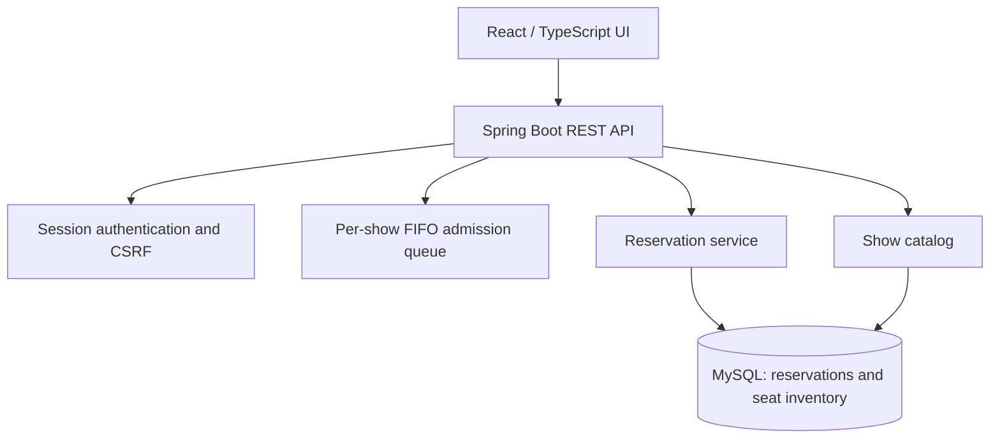
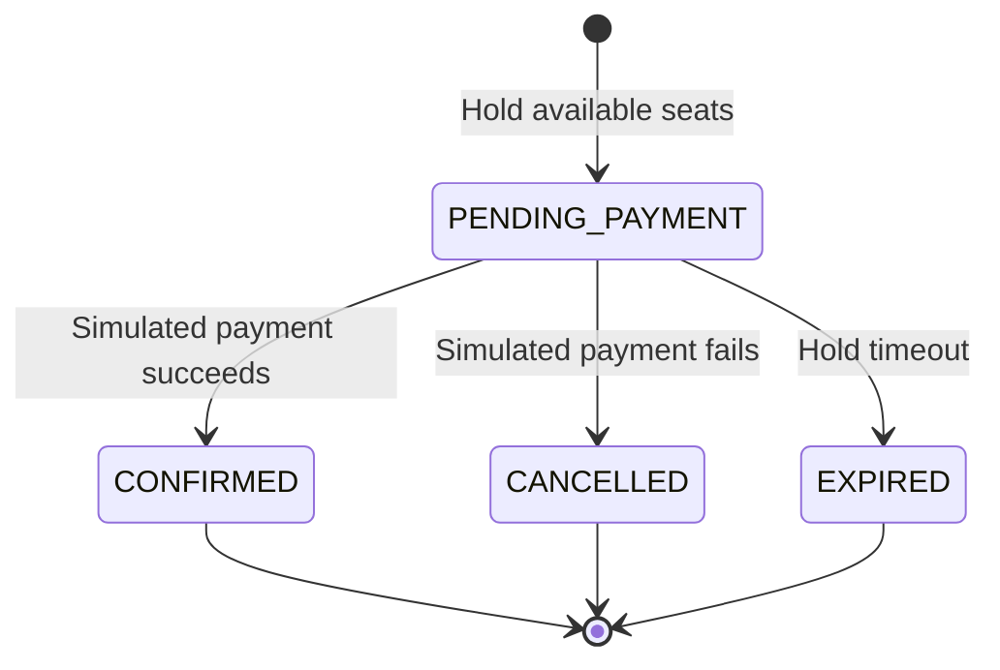

# TrafficG — Concert Reservation & Waiting-Room System

**A full-stack engineering prototype for reasoning about admission fairness, concurrent seat reservations, and transaction correctness.**

TrafficG models a concert-ticketing workflow in which many visitors can compete for a limited number of seats. Rather than treating the waiting room as an animation, it connects admission decisions to backend state and protects seat allocation with database transactions.

**Stack:** Java 17 · Spring Boot 3.4 · Spring Security · Spring Data JPA · MySQL 8 · React 19 · TypeScript · Vite · Docker Compose

> **Project status:** Local, single-instance prototype. Payment is simulated; this repository does not contain a deployed production system, a real payment gateway, Redis-backed distributed admission, or published load-test results.

## The engineering problem

An event can attract more buyers than the system should admit at once. Even after admission, two buyers may attempt to reserve the same seat. This creates distinct correctness requirements:

1. **Admission control:** admit only a bounded number of active visitors for a given show; keep the remainder in FIFO order.
2. **Inventory integrity:** prevent conflicting requests from simultaneously allocating the same seat.
3. **Bounded ownership:** release seats if payment is not confirmed within the hold window.
4. **Trust boundaries:** let the server, not browser-supplied positions, prices, or payment states, decide whether a booking succeeds.

This project is an implementation exercise in these constraints, with explicit limitations described below.

## Architecture



The admission queue is synchronized **in application memory** and supports one running backend instance. Seat holds and booking outcomes are persisted in MySQL.

## Implemented workflow

1. **Register and sign in.** Accounts use BCrypt password hashes; authenticated requests use a server-side session and CSRF protection.
2. **Browse performances.** The backend exposes show details and live seat states. Optional fictional seed data provides three shows with 48 seats each.
3. **Join the waiting room.** The server issues a ticket associated with the signed-in user and show. Three visitors per show are admitted; others receive their current queue position. The client polls the server rather than inventing a position.
4. **Hold seats.** Admitted visitors select one to four seats. A transaction acquires pessimistic row locks for those seats, validates availability, and persists one reservation with a five-minute hold.
5. **Confirm a simulated payment.** The backend computes the amount (₩6,000 per seat), checks reservation ownership and hold expiry, and marks the seats sold on success. It can also cancel a reservation for a simulated failure.
6. **Expire abandoned holds.** A scheduled backend task releases expired reservations. Expired holds can also be reclaimed when a later reservation acquires the seat rows.

### Reservation state model



**Concurrency boundary:** MySQL row locks serialize requests targeting the same seats. A reservation requires all requested seats to be available; otherwise the transaction fails rather than partially reserving the selection.

## Repository layout

```text
src/main/java/com/project/backend/
  auth/          Account registration, login, session security
  catalog/       Performances and seat inventory
  queue/         Per-show admission and ticket validation
  booking/       Transactional holds, payment simulation, expiration
src/test/        Queue and reservation tests
frontend/frontend/src/
  api/           Typed HTTP clients and CSRF handling
  pages/         Show listing, waiting room, seats, checkout
docs/           Integration notes and historical planning materials
compose.yaml     Local MySQL service
```

## Run locally

Prerequisites: **Java 17**, **Node.js + npm**, **Docker with Compose**.

1. Clone this repository, then copy the example environment file:

   ```bash
   cp .env.example .env
   ```

2. Set nonempty values for **DB_PASSWORD** and **MYSQL_ROOT_PASSWORD** in your local, untracked `.env` file.
3. Start MySQL, then load the same environment values into the backend shell:

   ```bash
   docker compose up -d mysql
   set -a
   source .env
   set +a
   ./gradlew bootRun
   ```

4. In a second terminal, launch the frontend:

   ```bash
   cd frontend/frontend
   npm ci
   npm run dev
   ```

5. Visit the URL printed by Vite (usually `http://localhost:5173`). Vite proxies `/api` requests to Spring Boot on port `8080`; MySQL is accessible on loopback port `3307`.

With `DEMO_SEED=true`, the catalog receives three fictional performances if the show table is empty. Create an account and sign in to enter a waiting room. The registration form accepts a 7–20-character alphanumeric ID beginning with a letter, and an 8–12-character password containing letters, a digit, and a supported special character.

### Tests and build checks

```bash
./gradlew test
cd frontend/frontend
npm ci
npm run build
```

Queue unit tests exercise FIFO promotion, ownership, per-show isolation, and single-use admission claims. H2-backed service tests cover reservation conflicts, all-or-nothing seat selection, ownership, and payment confirmation. H2 is for local tests; the primary persistence design targets MySQL.

## Selected API endpoints

| Method | Route | Purpose |
| --- | --- | --- |
| `POST` | `/api/auth/signup` | Create an account |
| `POST` | `/api/auth/login` | Authenticate and start a session |
| `GET` | `/api/auth/me` | Inspect the current session |
| `GET` | `/api/shows` | List performances |
| `GET` | `/api/shows/{id}/seats` | Inspect current seat availability |
| `POST` | `/api/queue/join` | Enter the per-show queue |
| `GET` | `/api/queue/{ticketId}` | Poll admission status |
| `POST` | `/api/reservations` | Create a transactional seat hold |
| `POST` | `/api/reservations/{id}/payment` | Simulate payment confirmation |

Mutating requests require a CSRF token obtained from `GET /api/auth/csrf`. The React client includes the session cookie and token automatically. Queue tickets are also bound to the authenticated user.

## Limitations and next experiments

| Current prototype | Next validation or design step |
| --- | --- |
| Java in-memory FIFO; one server process | Shared-state admission via Redis and atomic admission/expiry semantics |
| Three active admissions per show | Arrival-rate, fairness, cancellation, and throughput measurements |
| Pessimistic database seat locks | Contention tests with concurrent clients; deadlock/retry policies |
| Scheduled five-minute hold expiration | Clock-controlled boundary tests and recovery after service failure |
| Session-based authentication and demo user registration | Security review: rate limits, account verification, stronger session lifecycle and abuse controls |
| Simulated payment response | Idempotent payment-webhook processing and reconciliation with a sandbox provider |
| Development-time JPA schema updates | Versioned migrations and operational monitoring |

There are **no unverified performance claims** in this README. A useful follow-up experiment is to generate concurrent reservation requests for the same seat and record both the conflict rate and database transaction latency.

## Project lineage

TrafficG is the **primary, integrated repository**. The earlier [TrafficJam](https://github.com/thereisnoriver/TrafficJam) project explored the ticket-buying and waiting-room experience using Vue and Spring Boot. This work adapts that user flow into TrafficG's React/Spring Boot architecture and replaces the earlier simulated waiting-room progress with server-owned admission tickets. TrafficJam remains available separately as a historical prototype; its entire source tree was not mechanically copied here.

The prior Korean schedule is retained in [docs/LEGACY_ROADMAP.md](docs/LEGACY_ROADMAP.md) for historical context. It is not a list of completed capabilities.

---

Maintained by [thereisnoriver](https://github.com/thereisnoriver). The focus is reproducible engineering, honest limitation reporting, and clear reasoning about concurrent systems.
